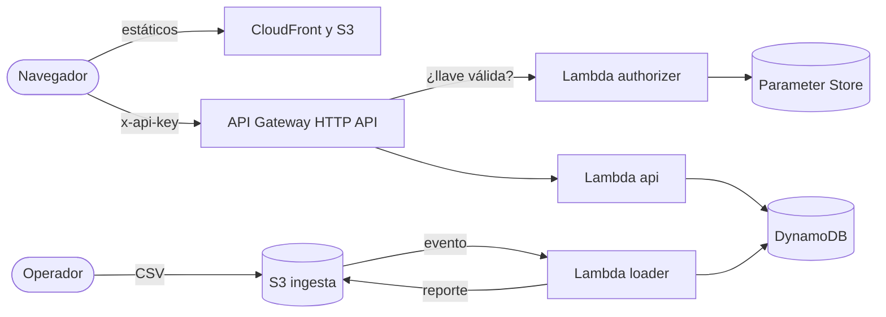

# Explorador de Datos Serverless

Aplicación web serverless en AWS para consultar el catálogo de volcanes del Holoceno del Smithsonian. Un CSV público se carga por eventos en DynamoDB y se consulta desde una interfaz de solo lectura, protegida con una llave.

## Alcance

- Infraestructura definida con Terraform y desplegada desde GitHub Actions, con la llave de un usuario IAM guardada en secretos de GitHub.
- Carga automática al subir el CSV a S3, con validación de tipos, reporte y reintentos.
- API HTTP de solo lectura: `GET /items` y `GET /items/{id}`.
- Interfaz web en React que permite consultar y explorar el catálogo de volcanes mediante estadísticas, gráficos, mapa interactivo, búsqueda, filtros, paginación y consulta del detalle de cada registro.

Quedan fuera el inicio de sesión, la escritura desde la interfaz y el dominio propio. El detalle está en [docs/arquitectura.md](docs/arquitectura.md).

## Arquitectura

`api` y `loader` están en Node.js 24, `authorizer` en Python 3.13 y la interfaz en React con Vite.

## Requisitos

- Para desplegar: una cuenta de AWS y permisos para ejecutar los workflows de este repositorio.
- Para el bootstrap: Bash, AWS CLI y credenciales temporales de administrador. Para guardar la llave en GitHub: `gh`.
- Para trabajar en local, según la parte: Node.js 24, Python 3.13 o Terraform 1.11 o superior.

## Ejecución local

Las validaciones locales no necesitan credenciales de AWS y son opcionales, porque los pipelines ejecutan las mismas en cada pull request.

| Parte | Comandos |
|---|---|
| `frontend/` | `npm ci`, `npm run dev`, `npm run test`, `npm run lint` y `npm run build`. Para ejecutar `npm run dev`, configurar `VITE_API_BASE_URL` con la URL de la API desplegada. |
| `services/api`, `services/loader`, `services/common` | `npm ci`, `npm run lint` y `npm test` |
| `services/authorizer` | `ruff check` y `pytest` |
| `infra/app` | `terraform fmt -check`, `terraform init -backend=false` y `terraform validate` |

El frontend utiliza `VITE_API_BASE_URL` para identificar la URL de la API desplegada. Durante el acceso, la aplicación solicita la API key al usuario y la conserva en `sessionStorage` durante la sesión del navegador.

## Despliegue en AWS

La solución se despliega en una cuenta de proyecto de AWS; en otro tipo de cuenta, las restricciones pueden ser distintas.

1. Ejecutar una vez `scripts/bootstrap.sh`, que crea el bucket de estado y el usuario IAM de despliegue con su política.
2. [Configurar GitHub](docs/detalle/despliegue.md#configuración-en-github): el Environment `aws`, limitado a `main`, con la llave del usuario en sus secretos, y la variable del repositorio `TF_STATE_BUCKET`.
3. Lanzar a mano, desde `main` y en orden, los workflows `infra.yml` con la acción `apply`, `lambdas.yml` y `web.yml`.

Después, cada cambio se integra por pull request. Un push a `main` despliega los cambios de `services/` y `frontend/`; en cambio, uno en `infra/` solo genera un plan, y se despliega al lanzar `infra.yml` con la acción `apply` después de revisarlo. La llave de la API la genera Terraform, se guarda en Parameter Store y nunca está en este repositorio. Más detalle en [docs/detalle/despliegue.md](docs/detalle/despliegue.md).

## Carga y verificación de datos

1. Descargar el CSV desde el navegador o con `curl -fsSL "<URL>" -o "volcanoes-$(date +%F).csv"`, usando la [URL de la fuente](docs/detalle/datos.md#dataset). Si se descarga desde el navegador, se guarda con el mismo nombre: la fecha identifica la copia fija contra la que se verifica la carga.
2. Si la carga debe quedar exacta, recrear antes la tabla con la opción manual `recreate-table` de `infra.yml`, porque la carga sobrescribe, pero no borra.
3. Subir un solo archivo a `incoming/` en el bucket de ingesta. La carga empieza sola y toma unos minutos.
4. Revisar `reports/<run_id>/summary.json`: el estado debe ser `SUCCEEDED`, con `rows_read` igual a `rows_written` y `rows_rejected` en 0.
5. Comparar `rows_read` con el conteo en vivo de la consola de DynamoDB.

## Destrucción del ambiente

Lanzar a mano, desde `main`, `infra.yml` con la opción `destroy`. Lo creado por el bootstrap se conserva y se elimina aparte. La llave de `eds-github-deploy` se desactiva con `aws iam update-access-key` y se borra con `aws iam delete-access-key`.

## Fuente de los datos

Global Volcanism Program, Smithsonian Institution, [volcano.si.edu](https://volcano.si.edu). El uso es sin fines comerciales y citando la fuente; los términos están en [docs/fuente-de-datos.md](docs/fuente-de-datos.md).

Cita de la base de datos:

> Global Volcanism Program, 2026. [Database] Volcanoes of the World (v. 5.4.0; 7 Aug 2026). Distributed by Smithsonian Institution, compiled by Venzke, E. https://volcano.si.edu/database/

## Mapa de documentación

| Documento | Contenido |
|---|---|
| [docs/arquitectura.md](docs/arquitectura.md) | Alcance, requisitos, vistas, flujos y riesgos. |
| [docs/adr/README.md](docs/adr/README.md) | Decisiones de arquitectura, con alternativas y motivo. |
| [docs/detalle/](docs/detalle/) | Datos, errores, funciones, seguridad, logs, despliegue, pruebas e interfaz. |
| [contracts/openapi.yaml](contracts/openapi.yaml) | Contrato de la API. |
| [services/README.md](services/README.md) | Funciones, estructura, validación local y empaquetado. |
| [frontend/README.md](frontend/README.md) | Interfaz web: funcionalidades, configuración, pruebas y compilación. |
| [CONTRIBUTING.md](CONTRIBUTING.md) | Convenciones de código, documentación, ramas y commits. |
