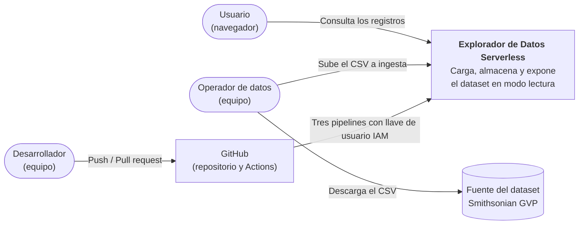
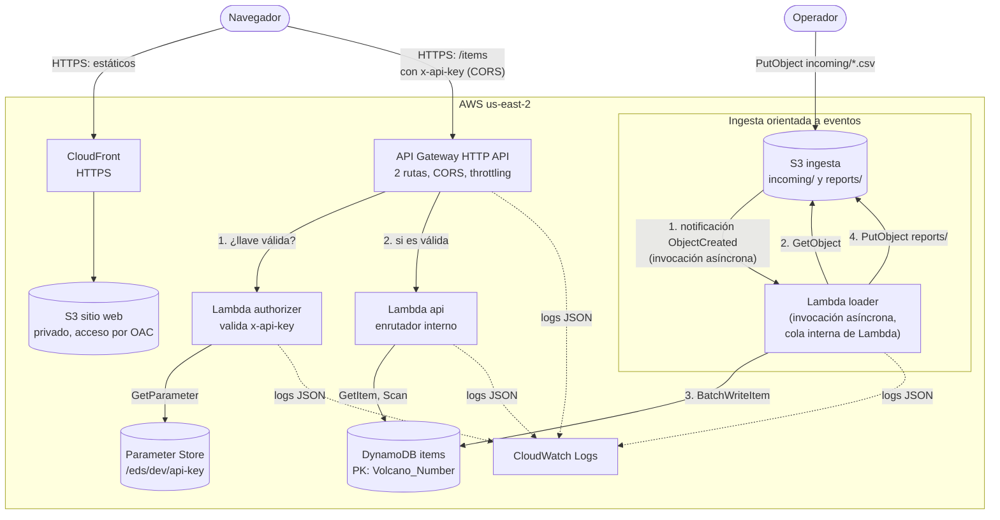

# Explorador de Datos Serverless: arquitectura

Proveedor: AWS. Las decisiones y sus alternativas están en [adr/README.md](adr/README.md); este documento solo las cita. Los valores marcados con *(verificar)* son supuestos que se confirman al implementar.

## 1. Propósito y alcance

El sistema toma un CSV público, lo carga en una base de datos serverless y lo expone en una aplicación web de solo lectura, protegida con una llave compartida. En ella se muestran los registros y se consulta uno por su identificador. El dataset es el catálogo de volcanes del Holoceno del Smithsonian ([ADR-0011](adr/ADR-0011-dataset-holocene-volcanoes.md)). Se elige serverless porque la carga es intermitente y orientada a eventos: la ingesta ocurre solo cuando llega un archivo, las consultas son esporádicas y cada operación es pequeña y corta.

**Dentro del alcance:**

1. Infraestructura en AWS definida con Terraform.
2. Ingesta orientada a eventos: el CSV llega a un bucket, S3 invoca de forma asíncrona una función que valida y tipa los registros, los escribe en DynamoDB y deja un reporte.
3. API HTTP de solo lectura con dos operaciones (listado paginado y consulta por identificador), que exige la llave en la cabecera `x-api-key`.
4. Contrato OpenAPI como fuente única de verdad entre backend y frontend, y requisitos funcionales de la interfaz web, sin su diseño visual.
5. Validaciones y pruebas locales sin credenciales de AWS ni emuladores, y pipelines independientes en GitHub Actions para infraestructura, funciones y sitio web.

**Fuera del alcance:**

1. Diseño visual y vistas de la interfaz, a criterio de quien la desarrolle dentro de sus [requisitos](detalle/interfaz.md).
2. Escritura de datos desde la interfaz, e inicio de sesión y gestión de usuarios ([ADR-0007](adr/ADR-0007-lambda-authorizer-llave-compartida.md)).
3. Dominio propio; se usa el de CloudFront ([ADR-0005](adr/ADR-0005-cloudfront-bucket-privado.md)).
4. Búsqueda por nombre, de texto libre o parcial, e imágenes del catálogo ([ADR-0015](adr/ADR-0015-busqueda-por-identificador-sin-imagenes.md)).
5. Redes privadas (VPC): todos los servicios son administrados y se consumen con IAM.
6. Múltiples ambientes: se diseña para `dev`, aunque el código queda parametrizado por ambiente.
7. Cola de fallos ([ADR-0006](adr/ADR-0006-ingesta-s3-lambda-asincrona.md)) y agregados precalculados ([ADR-0014](adr/ADR-0014-agregados-precalculados.md)).

## 2. Objetivos y requisitos

| Id | Objetivo | Cómo se mide |
|---|---|---|
| O-1 | Cargar el 100 % de los registros conservando estructura y tipos. | El reporte cumple `rows_read = rows_written` con `rows_rejected = 0`, y el conteo en vivo de la consola de DynamoDB coincide con `rows_read`. |
| O-2 | Encontrar un registro por su identificador. | La consulta responde correctamente en menos de 1 s con la función ya iniciada (RNF-01 fija el arranque en frío). |
| O-3 | Costo cercano a cero. | DynamoDB se mantiene en su capa gratuita y ningún componente cobra por estar encendido; el resto cuesta centavos ([costos](detalle/despliegue.md#costos)). |
| O-4 | Infraestructura reproducible y desechable. | `terraform apply` crea la pila `app` y `terraform destroy` la elimina sin pasos manuales (buckets con `force_destroy = true`). Lo creado por el bootstrap se conserva aparte. |
| O-5 | Trabajo en paralelo. | El frontend se desarrolla en local contra la API desplegada, con la llave; las funciones se prueban localmente sin cuenta de AWS. |

**Requisitos funcionales** (todos de prioridad alta):

| Id | Requisito |
|---|---|
| RF-01 | Al subir un CSV al prefijo `incoming/` del bucket de ingesta, el sistema lo carga automáticamente en la base de datos. |
| RF-02 | La carga valida cada fila contra un contrato de esquema (columnas, tipos, obligatoriedad, unicidad de la clave primaria) y convierte cada valor a su tipo. |
| RF-03 | Cada carga genera un reporte en S3 con conteos, duración, estado y el detalle de las filas rechazadas con su código de error. |
| RF-04 | La API lista los registros de forma paginada. |
| RF-05 | La API devuelve un registro por su identificador principal. |
| RF-06 | La interfaz web muestra los registros y permite buscar uno por su identificador. La presentación queda a criterio de quien la desarrolle. |
| RF-07 | Volver a procesar el mismo archivo deja la base de datos en el mismo estado (carga idempotente). |
| RF-08 | Una carga que falla de forma repetida queda registrada en el reporte o en los logs, y se repite volviendo a subir el archivo. |
| RF-09 | La API solo atiende peticiones con una llave válida. La interfaz la pide al ingresar y no permite continuar sin ella. |

**Atributos de calidad:**

| Id | Atributo | Criterio de aceptación |
|---|---|---|
| RNF-01 | Desempeño | Con la función ya iniciada, una consulta responde en menos de 300 ms (p95) medido en API Gateway. En arranque en frío se tolera hasta 1,5 s *(verificar)*. |
| RNF-02 | Seguridad | Cada función tiene su propio rol IAM con las acciones mínimas sobre los recursos que usa. Ningún bucket es público. El sitio se sirve por HTTPS. Ninguna llave queda en el repositorio ni en los estáticos. La automatización usa una llave de larga duración de un usuario IAM, guardada en secretos de GitHub ([ADR-0012](adr/ADR-0012-pipelines-github-actions.md)). |
| RNF-03 | Integridad de datos | Los tipos de cada columna se conservan (enteros y decimales como números, y texto como cadena). Ninguna fila se pierde en silencio: en una carga completa, cada una se escribe o queda en el reporte de rechazos. Si la carga termina en `FAILED`, el reporte lo indica y se repite. |
| RNF-04 | Confiabilidad de la ingesta | Un fallo transitorio de la carga se reintenta automáticamente; un fallo persistente queda en el reporte `FAILED` o en los logs, y la carga se repite volviendo a subir el archivo. |
| RNF-05 | Observabilidad | Toda petición y toda carga dejan logs estructurados en JSON con un identificador de correlación que también se devuelve al cliente. |
| RNF-06 | Capacidad | Con el ritmo de escritura de 20 WCU/s y el timeout de 300 s, una carga admite hasta unas 4 800 WCU, con 60 s de margen. El dataset consume unas 2 650 WCU *(estimado; verificar en la carga real)*. |
| RNF-07 | Mantenibilidad | Cambiar de dataset requiere cambiar el contrato de esquema, el OpenAPI, la interfaz y, si cambia el tipo de la clave, la tabla en Terraform. La cadena de validación, el escritor y la infraestructura restante no cambian. |
| RNF-08 | Reproducibilidad | Todo recurso se crea con Terraform, salvo lo previo que crea el script de bootstrap (bucket de estado y usuario IAM de despliegue con su política) y la llave de ese usuario, que se crea con un comando aparte; no hay cambios manuales en la consola. |
| RNF-09 | Protección ante abuso | La API aplica límites de tasa (throttling) para acotar costo y abuso. |
| RNF-10 | Costo de datos | La tabla no supera las 25 WCU y 25 RCU aprovisionadas de la capa gratuita de DynamoDB ([ADR-0002](adr/ADR-0002-dynamodb-aprovisionado.md)). |

## 3. Restricciones y supuestos

1. AWS, región `us-east-2` ([ADR-0010](adr/ADR-0010-region-us-east-2.md)).
2. Solo servicios administrados: S3, CloudFront, API Gateway, Lambda, DynamoDB, Systems Manager Parameter Store, CloudWatch e IAM.
3. Terraform ≥ 1.11 con los proveedores `hashicorp/aws` ~> 6.0, `hashicorp/archive` y `hashicorp/random` *(verificar versión al iniciar)*. Lo único previo a Terraform es el [bootstrap](detalle/despliegue.md#bootstrap) y la llave del usuario de despliegue.
4. Funciones empaquetadas como ZIP: `api` y `loader` en Node.js 24, y `authorizer` en Python 3.13 ([ADR-0016](adr/ADR-0016-lenguajes-de-las-funciones.md), [ADR-0001](adr/ADR-0001-funciones-empaquetadas-zip.md)).
5. La interfaz se construye con React y Vite y compila a estáticos (SPA), servidos por CloudFront desde un bucket privado.
6. La URL base de la API llega como variable de entorno al compilar. La llave nunca se compila: la escribe quien usa el sitio.

Se supone, además, que el dataset tiene una columna de identificador único, que se usa sin fines comerciales citando la fuente ([términos](fuente-de-datos.md)) y que el volumen de consultas es bajo (decenas o cientos por día).

## 4. Vistas

### Contexto

### Contenedores

### Componentes

| Componente | Tecnología | Responsabilidad | ADR |
|---|---|---|---|
| Sitio web | CloudFront y S3 privado | Sirve el build de la SPA por HTTPS. | [ADR-0005](adr/ADR-0005-cloudfront-bucket-privado.md) |
| API | API Gateway HTTP API | Expone dos rutas, exige el authorizer, maneja CORS y aplica throttling. | [ADR-0003](adr/ADR-0003-api-gateway-http-api.md) |
| Control de acceso | Lambda `authorizer` y Parameter Store | Compara `x-api-key` con la llave guardada antes de invocar la función de API. | [ADR-0007](adr/ADR-0007-lambda-authorizer-llave-compartida.md) |
| Función de API | Lambda `api` | Atiende las dos rutas con un enrutador interno. | [ADR-0004](adr/ADR-0004-funcion-por-microservicio.md) |
| Datos | DynamoDB aprovisionado | Almacena los registros. | [ADR-0002](adr/ADR-0002-dynamodb-aprovisionado.md) |
| Bucket de ingesta | S3 | Recibe el CSV y guarda los reportes de carga. | [ADR-0006](adr/ADR-0006-ingesta-s3-lambda-asincrona.md) |
| Función de carga | Lambda `loader` | Se invoca de forma asíncrona con la notificación de S3; valida, tipa y escribe a un ritmo controlado; genera el reporte. | [ADR-0006](adr/ADR-0006-ingesta-s3-lambda-asincrona.md), [ADR-0008](adr/ADR-0008-contrato-de-esquema.md) |
| Observabilidad | CloudWatch Logs | Access logs del gateway y logs de las tres funciones, con un [esquema común](detalle/logs.md). | No aplica |
| Automatización | GitHub Actions con llave de usuario IAM | Despliega infraestructura, funciones y sitio con una llave guardada en secretos de GitHub. | [ADR-0012](adr/ADR-0012-pipelines-github-actions.md) |

## 5. Flujos principales

### Consulta con llave

1. El navegador llama a la API con `x-api-key`. Sin la cabecera, API Gateway responde 401 sin invocar el authorizer.
2. El authorizer valida la llave, con caché de 300 s por llave. Si no es válida, API Gateway responde 403.
3. La función `api` enruta y valida el `id`, consulta DynamoDB con `GetItem` y responde con `x-request-id`. La secuencia completa está en [detalle/funciones.md](detalle/funciones.md#api).

### Carga

1. El operador sube `incoming/volcanoes-AAAA-MM-DD.csv` y S3 invoca `loader` de forma asíncrona.
2. La función lee el archivo en streaming, valida con la cadena, escribe por lotes a ritmo limitado y, al terminar, deja el reporte en `reports/`.
3. Si ocurre un error reintentable, Lambda reintenta hasta 2 veces y, si persiste, descarta el evento. El fallo queda en el reporte o en los logs, y el archivo sigue en `incoming/` para repetir la carga.

### Despliegue

Se trabaja por pull request. Un push a `main` dispara el pipeline de la carpeta que cambió: `infra/` aplica Terraform, `services/` actualiza el código de las funciones y `frontend/` compila, sincroniza el bucket e invalida CloudFront. Los jobs que despliegan usan la llave del usuario IAM, guardada en el Environment `aws` de GitHub. El detalle y el orden del primer despliegue están en [detalle/despliegue.md](detalle/despliegue.md).

## 6. Riesgos y limitaciones

| Riesgo o limitación | Impacto | Mitigación |
|---|---|---|
| Límite del patrón: una función corre máximo 15 minutos, y una carga sostenida y alta sale mejor en un contenedor de larga vida. | Acota el tamaño de una carga (RNF-06). | Aceptado para este volumen. |
| La carga no termina dentro del timeout de la función. | El reporte queda en `FAILED` con `TIME_LIMIT_REACHED`. | Medirla con el archivo real; bajar el consumo no es posible sin quitar columnas, así que se sube el timeout (máximo 900 s). |
| El escritor, otras tablas, dos cargas simultáneas o un evento duplicado superan las 25 WCU. | Throttling. | Ritmo de 20 WCU/s, sin autoescalado ni otras tablas aprovisionadas en la región, y un archivo a la vez. Si ocurre, los reintentos y la idempotencia protegen el resultado. |
| La carga sobrescribe por clave primaria, pero no borra: un volcán retirado o una fila de prueba sigue en la tabla. | Datos sobrantes y un conteo distinto al del archivo. | Antes de una carga que deba quedar exacta, recrear la tabla con la opción manual `recreate-table` de `infra.yml`. No se borra ítem por ítem porque consume más capacidad y deja la tabla incompleta si falla. |
| Varias peticiones seguidas con `limit=100` superan las 25 RCU. | Respuestas `503 DEPENDENCY_UNAVAILABLE`. | Aceptado para este volumen. Si la interfaz recorre toda la tabla, pide las páginas en secuencia y espaciadas ([interfaz](detalle/interfaz.md#qué-conviene-saber)). |
| Una función que muere sin escribir su reporte (timeout o memoria) y agota los reintentos. | Lambda descarta el evento y el fallo solo queda en los logs. | Se revisan los logs tras cada carga y se vuelve a subir el archivo. |
| La llave es compartida y no identifica personas; si se filtra, da acceso de lectura. | Lectura no autorizada de datos públicos. | Se rota incrementando `api_key_version`. La anterior puede seguir válida hasta 5 minutos por la caché, y hasta otros 5 por la relectura de la función. |

Limitaciones de la API: el listado no tiene orden garantizado, porque `Scan` recorre la tabla por particiones (la interfaz puede ordenar dentro de la página); no hay total de páginas, por la paginación con token; la búsqueda es solo por identificador exacto; y no hay una operación de agregados, de modo que cualquier resumen se calcula en la interfaz con las páginas que obtenga.

## 7. Mapa de la documentación

| Documento | Contenido |
|---|---|
| [contracts/openapi.yaml](../contracts/openapi.yaml) | Contrato de la API con ejemplos. Ante cualquier diferencia, manda este archivo. Agregar campos opcionales es compatible; quitar, renombrar o cambiar un tipo exige acordarlo y actualizarlo primero. |
| [adr/README.md](adr/README.md) | Decisiones de arquitectura, con alternativas y motivo. |
| [detalle/datos.md](detalle/datos.md) | Dataset, tabla, tipos, contrato de esquema y reporte. |
| [detalle/errores.md](detalle/errores.md) | Formato y catálogos de errores, reintentos e idempotencia. |
| [detalle/funciones.md](detalle/funciones.md) | Capas, patrones y buenas prácticas de las Lambdas, ingesta y authorizer. |
| [detalle/seguridad.md](detalle/seguridad.md) | Permisos por rol, llave, buckets y CORS. |
| [detalle/logs.md](detalle/logs.md) | Esquema común de logs, eventos y correlación de una petición. |
| [detalle/despliegue.md](detalle/despliegue.md) | Recursos y nombres, Terraform, bootstrap, pipelines, primer despliegue y costos. |
| [detalle/pruebas.md](detalle/pruebas.md) | Validaciones locales y niveles de prueba. |
| [detalle/interfaz.md](detalle/interfaz.md) | Requisitos UI-01 a UI-07. |
| [fuente-de-datos.md](fuente-de-datos.md) y [CONTRIBUTING.md](../CONTRIBUTING.md) | Fuente del dataset, cita y términos de uso; convenciones de código, documentación, ramas y commits. |
