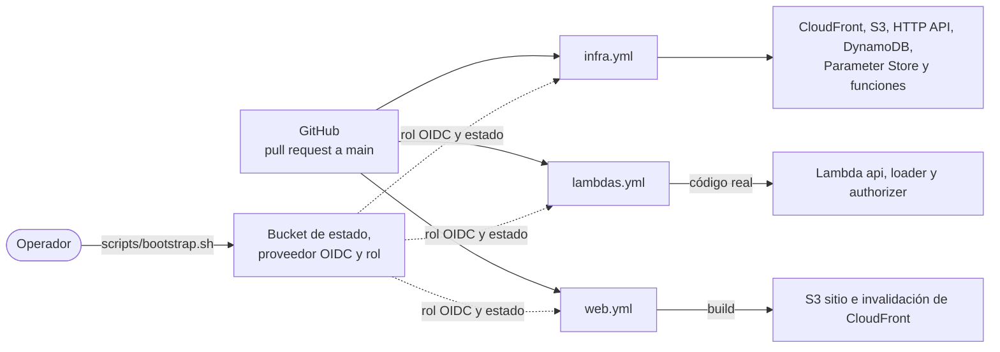

# Despliegue

## Recursos y nombres

Convención: `eds-<ambiente>-<recurso>`. Todas las etiquetas incluyen `project=eds`, `env` y `managed_by=terraform`.

| Recurso | Nombre (ambiente `dev`) | Se crea con |
|---|---|---|
| Bucket de estado de Terraform | `eds-tfstate-<account_id>` | `scripts/bootstrap.sh` |
| Proveedor OIDC y rol de despliegue | `eds-github-deploy` | `scripts/bootstrap.sh` |
| Distribución de CloudFront (`PriceClass_100`) y OAC | `eds-dev-web` | Terraform `app` |
| Bucket sitio web | `eds-dev-web-<account_id>` | Terraform `app` |
| Bucket ingesta | `eds-dev-ingest-<account_id>` | Terraform `app` |
| HTTP API | `eds-dev-api` | Terraform `app` |
| Funciones | `eds-dev-api`, `eds-dev-loader`, `eds-dev-authorizer` | Terraform `app` |
| Parámetro de la llave | `/eds/dev/api-key` | Terraform `app` |
| Tabla | `eds-dev-items` | Terraform `app` |
| Grupos de logs | [Uno por función y uno del gateway](logs.md#grupos-de-logs-y-retención) | Terraform `app` |

## Repositorio

Carpetas: `contracts/`, `services/` (`common`, `authorizer`, `api`, `loader`), `frontend/`, `infra/app/`, `scripts/`, `docs/` y `.github/workflows/`.

| Script | Función |
|---|---|
| `scripts/bootstrap.sh` | Crea el bucket de estado, el proveedor OIDC y el rol de despliegue. |
| `scripts/deploy-policy.json` | Permisos del rol de despliegue. |
| `scripts/download-dataset.py` | Descarga el CSV de la fuente con la fecha en el nombre. |
| `scripts/package-lambda.sh` | Arma el ZIP de cada función con `services/<función>/src`; `api` y `loader` incluyen además `services/common` y sus dependencias de producción. |

## Terraform

Una sola pila, `infra/app`, que se aplica desde GitHub Actions. Se organiza por archivos temáticos en lugar de módulos. El estado usa el backend S3 con bloqueo nativo (`use_lockfile = true`), de modo que no hace falta una tabla de bloqueo; el bucket llega por `-backend-config`.

Las variables propias son `cors_allow_origins` y `api_key_version`. Las salidas son la URL del sitio, la URL de la API y los nombres de los buckets y de la distribución.

**Código de las funciones ([ADR-0001](../adr/ADR-0001-funciones-empaquetadas-zip.md)).** Terraform las crea con un ZIP provisional por lenguaje (`archive_file` sobre `placeholder/`) que siempre lanza una excepción, de modo que no concede acceso. Un CSV subido antes de tiempo se reintenta y se descarta, así que hay que volver a subirlo. Además, ignora los cambios posteriores de su código (`ignore_changes`). El código real lo despliega `lambdas.yml`. Si Terraform recrea una función, vuelve el código provisional y hay que ejecutar `lambdas.yml` otra vez.

## Vista de despliegue

## Bootstrap

Es lo que debe existir antes de que GitHub pueda desplegar y que el pipeline no puede crear por sí mismo. `scripts/bootstrap.sh` se ejecuta una vez y se puede repetir sin efectos adversos. Requiere Bash (Linux o WSL), AWS CLI y credenciales temporales de administrador de la cuenta. Crea:

1. El bucket de estado de Terraform, con versionado, cifrado y sin acceso público.
2. El proveedor OIDC de GitHub (`token.actions.githubusercontent.com`).
3. El rol `eds-github-deploy`, con la política de `scripts/deploy-policy.json` y [confianza limitada](seguridad.md#permisos-por-rol). La política incluye los permisos que exige activar los access logs del gateway, como `logs:CreateLogDelivery`.

Al terminar, imprime el ARN del rol y el nombre del bucket, que se guardan como variables del repositorio; no son secretos.

## Pipelines

Cada componente tiene su pipeline ([ADR-0012](../adr/ADR-0012-pipelines-github-actions-oidc.md)), que se dispara cuando cambia su carpeta o de forma manual (`workflow_dispatch`). Así, cada persona despliega desde el repositorio, sin configurar credenciales de AWS en su equipo. En un pull request se valida sin credenciales; en `main`, además, se despliega.

| Workflow | Se dispara por | En pull request | En `main` |
|---|---|---|---|
| `infra.yml` | `infra/**` o manual | `terraform fmt -check`, `terraform init -backend=false` y `terraform validate` | `terraform plan` y `terraform apply` de `app`. De forma manual, el parámetro `action` permite elegir `apply`, `recreate-table` (`terraform apply -replace` solo sobre la tabla) o `destroy` |
| `lambdas.yml` | `services/**` o manual | `npm ci`, `npm run lint` y `npm test` en `api`, `loader` y `common`; `ruff` y `pytest` en `authorizer` | Lo mismo, y actualiza el código de las tres funciones |
| `web.yml` | `frontend/**` o manual | `npm ci`, `npm run lint` y `npm run build` | Lee la URL de la API con `terraform output`, compila con ella en `VITE_API_BASE_URL`, y ejecuta `aws s3 sync` y la invalidación de CloudFront |

Con un repositorio público, los runners estándar de GitHub Actions no tienen costo.

## Primer despliegue

Después del bootstrap, se ejecutan a mano y en orden `infra.yml`, `lambdas.yml` y `web.yml`. Si el primer push toca las tres carpetas y sus ejecuciones fallan o se adelantan, basta con relanzarlas en este orden.

La carga de datos no es un workflow: un operador descarga el archivo con `scripts/download-dataset.py` o desde el navegador, lo sube a `incoming/`, desde la consola de S3 o con `aws s3 cp`, y consulta el reporte en `reports/` ([verificación](pruebas.md#verificación-de-la-carga)).

## Costos

*(Estimación con los precios publicados por AWS; confirmar en la consola de facturación.)*

Se despliega en una cuenta nueva con el **Free plan** de AWS: incluye 100 USD en créditos, con opción de ganar otros 100, y no genera cobros. A cambio, la cuenta se cierra a los 6 meses o al agotar los créditos, y solo da acceso a servicios seleccionados. Por eso se verifica la disponibilidad al crear la cuenta y, si falta un servicio, se pasa al plan de pago, con presupuesto y usando los créditos. El cierre de la cuenta es aceptable, porque toda la infraestructura se recrea con Terraform.

| Servicio | Asignación gratuita | Consumo esperado | Costo esperado |
|---|---|---|---|
| DynamoDB | 25 WCU, 25 RCU y 25 GB, por región y por cuenta | 25 WCU, 25 RCU y unos 2 MB | Cero |
| Lambda | 1 millón de peticiones y 400 000 GB-segundo al mes | Pocas invocaciones | Cero |
| CloudFront | 1 TB y 10 millones de peticiones al mes, permanente | Muy bajo | Cero |
| Parameter Store | Parámetros estándar sin costo adicional | 1 parámetro | Cero; el cifrado de `SecureString` está por confirmar *(verificar)* |
| API Gateway HTTP | A 1 USD por millón de llamadas; cubierto por créditos si no aplica una asignación gratuita | Miles de llamadas | Menos de 1 centavo |
| S3 | Cubierto por créditos si no aplica una asignación gratuita | Unos pocos MB | Centavos |
| CloudWatch Logs | 5 GB al mes entre ingesta, almacenamiento y consultas | Pocos MB, con retención de 14 días | Cero |
