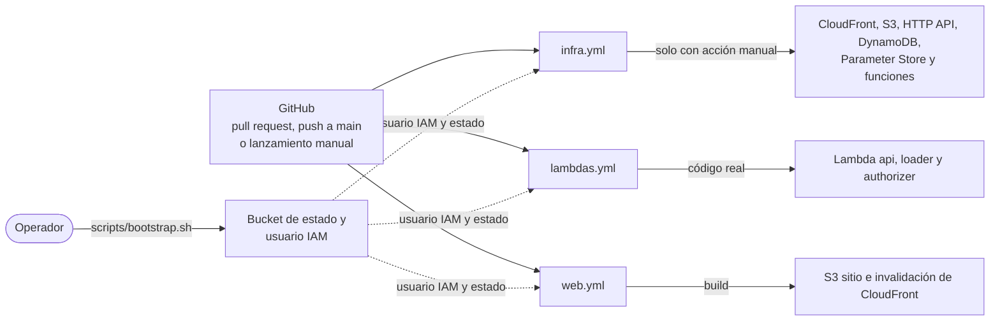

# Despliegue

## Recursos y nombres

Convención: `eds-<ambiente>-<recurso>`. Todas las etiquetas incluyen `project=eds`, `env` y `managed_by=terraform`.

| Recurso | Nombre (ambiente `dev`) | Se crea con |
|---|---|---|
| Bucket de estado de Terraform | `eds-tfstate-<account_id>` | `scripts/bootstrap.sh` |
| Usuario IAM de despliegue y su política administrada | `eds-github-deploy` | `scripts/bootstrap.sh` |
| Distribución de CloudFront (`PriceClass_100`) y OAC | `eds-dev-web` | Terraform `app` |
| Bucket sitio web | `eds-dev-web-<account_id>` | Terraform `app` |
| Bucket ingesta | `eds-dev-ingest-<account_id>` | Terraform `app` |
| HTTP API | `eds-dev-api` | Terraform `app` |
| Funciones | `eds-dev-api`, `eds-dev-loader`, `eds-dev-authorizer` | Terraform `app` |
| Parámetro de la llave | `/eds/dev/api-key` | Terraform `app` |
| Tabla | `eds-dev-items` | Terraform `app` |
| Grupos de logs | [Uno por función y uno del gateway](logs.md#grupos-de-logs-y-retención) | Terraform `app` |

## Repositorio

Carpetas: `contracts/`, `services/` (`common`, `authorizer`, `api`, `loader`), `frontend/`, `infra/app/`, `scripts/`, `docs/` y `.github/workflows/`.

| Script | Función |
|---|---|
| `scripts/bootstrap.sh` | Crea el bucket de estado y el usuario IAM de despliegue con su política. |
| `scripts/deploy-policy.json` | Permisos del usuario de despliegue. |
| `scripts/package-lambda.sh` | Arma el ZIP de cada función. `authorizer` usa `services/authorizer/src`; `api` y `loader` usan un solo `handler.mjs`, generado con esbuild, que incluye `services/common` y las dependencias de producción, salvo el AWS SDK del runtime. |
| `scripts/check-lambda-bundle.mjs` | Carga el handler empaquetado de `api` o `loader` desde una carpeta sin `node_modules`, con un AWS SDK simulado. |

## Terraform

Una sola pila, `infra/app`, que se aplica desde GitHub Actions. Se organiza por archivos temáticos en lugar de módulos. El estado usa el backend S3 con bloqueo nativo (`use_lockfile = true`), de modo que no hace falta una tabla de bloqueo; el bucket llega por `-backend-config`.

Las variables propias son `cors_allow_origins` y `api_key_version`. Las salidas son `site_url`, `api_url`, `web_bucket_name`, `ingest_bucket_name` y `cloudfront_distribution_id`; de la distribución se expone el ID, porque no tiene nombre y la invalidación lo usa.

**Código de las funciones ([ADR-0001](../adr/ADR-0001-funciones-empaquetadas-zip.md)).** Terraform las crea con un ZIP provisional por función (`archive_file` sobre `placeholder/<función>`), que se genera en `plan` o `apply`, no en `validate`. Además, ignora los cambios posteriores de su código (`ignore_changes`), porque el código real lo despliega `lambdas.yml`.

En el código provisional, `authorizer` y `loader` siempre lanzan una excepción, mientras que `api` responde 200 con un JSON fijo (`{"status":"placeholder"}`), sin tocar datos y fuera del contrato. Aun así, no concede acceso, porque el `authorizer` provisional lanza la excepción y las dos únicas rutas exigen authorizer. Por su parte, un CSV subido antes de tiempo se reintenta y se descarta, así que hay que volver a subirlo.

Si Terraform recrea una función, vuelve su código provisional y hay que ejecutar `lambdas.yml` otra vez. Con `api` hay un matiz: si se recrea mientras el `authorizer` real está activo, quien tenga una llave válida recibe ese JSON fijo hasta volver a ejecutar `lambdas.yml`.

## Vista de despliegue



## Bootstrap

Es lo que debe existir antes de que GitHub pueda desplegar y que el pipeline no puede crear por sí mismo. `scripts/bootstrap.sh` se ejecuta una vez y se puede repetir sin efectos adversos. Requiere Bash (Linux o WSL), AWS CLI y credenciales temporales de administrador de la cuenta. Crea:

1. El bucket de estado de Terraform, con versionado, cifrado y sin acceso público.
2. El usuario IAM `eds-github-deploy`, sin acceso a la consola.
3. La política administrada `eds-github-deploy`, con el contenido de `scripts/deploy-policy.json`, adjunta a ese usuario. La política incluye los permisos que exige activar los access logs del gateway, como `logs:CreateLogDelivery`.

Al terminar, imprime el nombre del usuario y del bucket. El script no crea la llave del usuario.

## Configuración en GitHub

Después del bootstrap, se configura el repositorio con `gh`, desde una copia del repositorio y en este orden.

1. Crear el Environment `aws` y limitarlo a la rama `main`. Así, solo los jobs que corren en `main` y declaran `environment: aws` pueden leer sus secretos:

```bash
gh api --method PUT 'repos/{owner}/{repo}/environments/aws' --input - <<'EOF'
{"deployment_branch_policy": {"protected_branches": false, "custom_branch_policies": true}}
EOF
gh api --method POST 'repos/{owner}/{repo}/environments/aws/deployment-branch-policies' \
  -f name=main -f type=branch
```

2. Guardar en la variable del repositorio `TF_STATE_BUCKET` el nombre del bucket que imprimió el bootstrap; no es un secreto:

```bash
gh variable set TF_STATE_BUCKET --body <bucket>
```

3. Crear la llave y guardarla en los secretos `AWS_ACCESS_KEY_ID` y `AWS_SECRET_ACCESS_KEY` del Environment, que es lo que indica `--env aws`. Los valores pasan por stdin, de modo que no quedan en pantalla ni en el historial de la terminal:

```bash
aws iam create-access-key --user-name eds-github-deploy \
  --query 'AccessKey.[AccessKeyId,SecretAccessKey]' --output text \
  | { read -r key_id secret_key \
      && printf '%s' "$key_id" | gh secret set AWS_ACCESS_KEY_ID --env aws \
      && printf '%s' "$secret_key" | gh secret set AWS_SECRET_ACCESS_KEY --env aws; }
```

Si `gh` falla, el valor secreto ya no se puede recuperar y los secretos pueden quedar inconsistentes. Se identifica la llave nueva con `aws iam list-access-keys --user-name eds-github-deploy`, se borra con `aws iam delete-access-key --user-name eds-github-deploy --access-key-id <id>` y se repite el comando.

4. Proteger la rama por defecto con un ruleset, de modo que `main` solo reciba cambios por pull request y no se pueda borrar ni reescribir. No exige aprobaciones, y ese límite forma parte del [riesgo aceptado](seguridad.md#riesgo-aceptado-del-usuario-de-despliegue):

```bash
gh api --method POST 'repos/{owner}/{repo}/rulesets' --input - <<'EOF'
{
  "name": "proteger-main",
  "target": "branch",
  "enforcement": "active",
  "conditions": {"ref_name": {"include": ["~DEFAULT_BRANCH"], "exclude": []}},
  "rules": [
    {"type": "deletion"},
    {"type": "non_fast_forward"},
    {
      "type": "pull_request",
      "parameters": {
        "dismiss_stale_reviews_on_push": false,
        "require_code_owner_review": false,
        "require_last_push_approval": false,
        "required_approving_review_count": 0,
        "required_review_thread_resolution": false
      }
    }
  ]
}
EOF
```

## Pipelines

Cada componente tiene su pipeline ([ADR-0012](../adr/ADR-0012-pipelines-github-actions.md)), que se dispara cuando cambia su carpeta o de forma manual (`workflow_dispatch`); `infra.yml` y `lambdas.yml`, además, cuando cambia el propio workflow, y `lambdas.yml`, cuando cambia `scripts/package-lambda.sh` o `scripts/check-lambda-bundle.mjs`. Así, cada persona despliega desde el repositorio, sin configurar credenciales de AWS en su equipo. En un pull request se valida sin credenciales. En `main`, los jobs que usan AWS declaran `environment: aws`, aunque los pipelines no despliegan igual: un push despliega con `lambdas.yml` y `web.yml`, mientras que `infra.yml` solo planea y aplica únicamente cuando se lanza a mano.

| Workflow | Se dispara por | En pull request | En `main` |
|---|---|---|---|
| `infra.yml` | `infra/**`, `.github/workflows/infra.yml` o manual | `terraform fmt -check`, `terraform init -backend=false` y `terraform validate` | En un push, la misma validación y `terraform plan`, sin aplicar. De forma manual, la misma validación y la [acción](#acciones-manuales-de-infrayml) que indique el parámetro `action` |
| `lambdas.yml` | `services/**`, `scripts/package-lambda.sh`, `scripts/check-lambda-bundle.mjs`, `.github/workflows/lambdas.yml` o manual | `npm ci`, `npm run lint` y `npm test` en `api`, `loader` y `common`; `ruff` y `pytest` en `authorizer`, solo en las carpetas que existan | Lo mismo, y actualiza el código de las funciones cuya carpeta exista |
| `web.yml` | `frontend/**` o manual | `npm ci`, `npm run lint` y `npm run build` | Lee la URL de la API con `terraform output`, compila con ella en `VITE_API_BASE_URL`, y ejecuta `aws s3 sync` y la invalidación de CloudFront |

Con un repositorio público, los runners estándar de GitHub Actions no tienen costo.

### Acciones manuales de `infra.yml`

| `action` | Plan que guarda y luego aplica | Efecto |
|---|---|---|
| `apply` (valor por defecto) | `terraform plan` | Aplica los cambios pendientes de `app`. |
| `recreate-table` | `terraform plan` con `-replace` y `-target` sobre `aws_dynamodb_table.items` | Recrea solo la tabla, que queda vacía. Los demás cambios pendientes siguen sin aplicar. |
| `destroy` | `terraform plan -destroy` | Elimina la pila `app`. Lo creado por el bootstrap se conserva. |

Las acciones corren en el job `terraform`, después de la validación, y solo desde `main`: un lanzamiento manual desde otra rama solo valida. Ese job declara `environment: aws` también al solo planear, porque el plan necesita la llave para leer el estado y consultar AWS. El pipeline fija Terraform 1.15.8.

Ninguna acción pausa entre plan y apply: el plan queda como registro en el log, y el control es revisar el plan del push antes de lanzar la acción manual. Este control tiene dos límites. Por un lado, el plan del push no anticipa lo que harán `recreate-table` ni `destroy`. Por otro, cada acción calcula su propio plan, que puede diferir del revisado si AWS o `main` cambiaron entretanto.

Por lo tanto, un cambio en `infra/` integrado en `main` no se despliega hasta lanzar `apply`, y `main` puede quedar por delante de lo desplegado. Si el plan muestra algo indeseado, AWS sigue intacto y se corrige con otro pull request. En cambio, `lambdas.yml` y `web.yml` sí despliegan al integrar, de modo que, si un cambio en `services/` o `frontend/` depende de infraestructura todavía sin aplicar, su pipeline se relanza después de `apply`.

## Primer despliegue

Después del bootstrap y de la configuración en GitHub, se ejecutan a mano, desde `main` y en orden `infra.yml` con la acción `apply`, `lambdas.yml` y `web.yml`. Un push no crea la infraestructura, porque `infra.yml` solo planea. Por eso, si el primer push toca las tres carpetas, las ejecuciones de `lambdas.yml` y `web.yml` que dispara pueden fallar o adelantarse, y basta con relanzarlas en este orden después de `apply`.

La carga de datos no es un workflow: un operador descarga el archivo desde el navegador o con [`curl`](datos.md#dataset), lo sube a `incoming/`, desde la consola de S3 o con `aws s3 cp`, y consulta el reporte en `reports/` ([verificación](pruebas.md#verificación-de-la-carga)).

## Costos

*(Estimación con los precios publicados por AWS; confirmar en la consola de facturación.)*

Se despliega en una cuenta nueva con el **Free plan** de AWS: incluye 100 USD en créditos, con opción de ganar otros 100, y no genera cobros. A cambio, la cuenta se cierra a los 6 meses o al agotar los créditos, y solo da acceso a servicios seleccionados. Por eso se verifica la disponibilidad al crear la cuenta y, si falta un servicio, se pasa al plan de pago, con presupuesto y usando los créditos. El cierre de la cuenta es aceptable, porque toda la infraestructura se recrea con Terraform.

| Servicio | Asignación gratuita | Consumo esperado | Costo esperado |
|---|---|---|---|
| DynamoDB | 25 WCU, 25 RCU y 25 GB, por región y por cuenta | 25 WCU, 25 RCU y unos 2 MB | Cero |
| Lambda | 1 millón de peticiones y 400 000 GB-segundo al mes | Pocas invocaciones | Cero |
| CloudFront | 1 TB y 10 millones de peticiones al mes, permanente | Muy bajo | Cero |
| Parameter Store | Parámetros estándar sin costo adicional | 1 parámetro | Cero; el cifrado de `SecureString` está por confirmar *(verificar)* |
| API Gateway HTTP | A 1 USD por millón de llamadas; cubierto por créditos si no aplica una asignación gratuita | Miles de llamadas | Menos de 1 centavo |
| S3 | Cubierto por créditos si no aplica una asignación gratuita | Unos pocos MB | Centavos |
| CloudWatch Logs | 5 GB al mes entre ingesta, almacenamiento y consultas | Pocos MB, con retención de 7 días | Cero |
