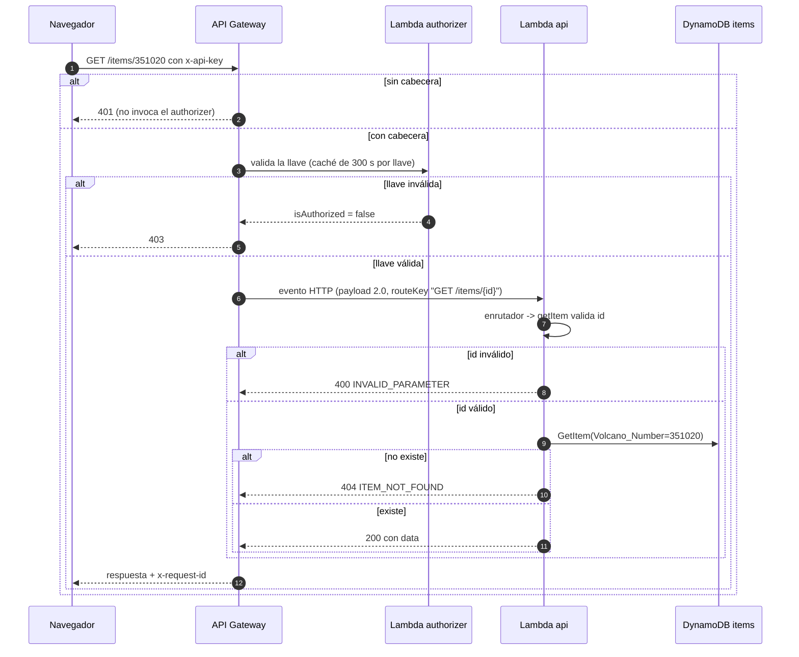
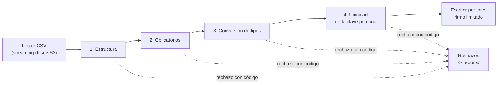

# Funciones Lambda

Las responsabilidades por componente están en [arquitectura.md](../arquitectura.md#componentes). La separación en tres funciones se explica en [ADR-0004](../adr/ADR-0004-funcion-por-microservicio.md), y sus lenguajes, en [ADR-0016](../adr/ADR-0016-lenguajes-de-las-funciones.md).

| Función | Runtime | Memoria | Timeout | Disparador |
|---|---|---|---|---|
| `authorizer` | `python3.13` | 128 MB | 5 s | Authorizer de API Gateway, con caché de 300 s por llave |
| `api` | `nodejs24.x` | 256 MB | 10 s | API Gateway (2 rutas) |
| `loader` | `nodejs24.x` | 512 MB | 300 s *(verificar en la carga real)* | Notificación de S3 (asíncrona) |

## Capas

`api` y `loader` comparten esta organización, de modo que la lógica se prueba sin AWS y un cambio de infraestructura no toca las reglas.

| Capa | Regla |
|---|---|
| `handler.mjs` | Traduce entre el evento de AWS y la lógica. Sin lógica de negocio ni llamadas al AWS SDK. En la API, contiene el enrutador. |
| `service.mjs` | Casos de uso. Recibe sus dependencias por constructor; no conoce la forma del evento. |
| `repository.mjs` | Único lugar donde se usa el AWS SDK. Traduce errores de AWS a excepciones propias (por ejemplo, throttling de DynamoDB a `DependencyUnavailable`). |
| `common/` | Errores, respuestas, logging, configuración, serialización y el contrato de esquema. Se empaqueta dentro del ZIP de `api` y `loader`, porque la carga valida con el contrato y la API lo usa para devolver como `null` las columnas ausentes. Se importa siempre con ruta relativa, por ejemplo, `../../common/logs.mjs`. El contrato también se importa, no se lee por ruta con `readFileSync`, porque esbuild solo incluye en el `handler.mjs` lo que se importa. |

Además, `loader` tiene `chain/` (manejadores de la cadena).

## Patrones

| Patrón | Dónde | Para qué |
|---|---|---|
| Enrutador (front controller) | Handler de la API: un objeto `routeKey -> función` (por ejemplo, `"GET /items/{id}" -> getItem`). | Una sola función atiende varias rutas sin cadenas de `if`. |
| Cadena de responsabilidad | Validación por fila en la carga. | Una regla por clase, que se prueba por separado. |
| Repositorio | Acceso a DynamoDB y S3. | Aislar AWS y facilitar pruebas. |
| Limitación de ritmo | Escritor de la carga. | Respetar la capacidad aprovisionada sin depender del throttling. |
| Mapeo centralizado de excepciones | `common/errors.mjs`. | Toda excepción se traduce a un único formato y código HTTP ([catálogo](errores.md#errores-de-la-api)), en un solo lugar. |

## API

`GET /items` usa `Scan`. El `next_token` es la clave de continuación de DynamoDB codificada en base64url, y en `null` significa que no hay más páginas. Las rutas, los parámetros y las respuestas están en [openapi.yaml](../../contracts/openapi.yaml).

Secuencia de una consulta con llave:

## Ingesta orientada a eventos

Nadie invoca la carga: la desencadena un evento ([ADR-0006](../adr/ADR-0006-ingesta-s3-lambda-asincrona.md)). S3 entrega la notificación a Lambda sin esperar el resultado; Lambda guarda el evento en una cola interna administrada por AWS y desde allí ejecuta la función. Si la ejecución falla, Lambda reintenta y, si sigue fallando, descarta el evento. Los valores de reintento están en [errores.md](errores.md#reintentos-e-idempotencia).

| Patrón de integración | Cómo se aplica | Qué aporta |
|---|---|---|
| Notificación de eventos (event notification) | S3 emite `ObjectCreated` cuando llega un objeto a `incoming/` con sufijo `.csv`. El evento solo dice qué archivo llegó; no lleva los datos. | Quien sube el archivo no conoce ni espera al procesador. |
| Invocación asíncrona con cola administrada | Lambda encola el evento internamente y lo procesa. | Reintentos ante fallos transitorios sin administrar ninguna cola. |
| Receptor idempotente (idempotent receiver) | Cada registro se escribe con su clave primaria. | S3 entrega eventos *al menos una vez* y Lambda puede reintentar: un evento repetido no duplica datos. |

Dos detalles de configuración evitan problemas conocidos:

1. **Sin bucles.** La notificación solo escucha `incoming/` y los resultados se escriben en `reports/`, de modo que la función nunca se dispara a sí misma.
2. **Permiso de invocación.** S3 necesita permiso explícito para invocar la función (`aws_lambda_permission` con el ARN del bucket como origen), y la notificación del bucket debe crearse después de ese permiso.

## Carga

El archivo se lee con `csv-parse`, porque Node.js no incluye un lector de CSV y hay saltos de línea dentro de celdas. Antes de la cadena por fila se validan el encabezado y el tamaño. La codificación se valida mientras se lee (`TextDecoder` con `fatal: true`), porque el archivo llega en streaming: un error a mitad de archivo detiene la carga, aunque ya haya filas escritas.

El escritor agrupa lotes de 10 ítems, pide a DynamoDB la capacidad consumida (`ReturnConsumedCapacity=TOTAL`) y espera lo necesario para mantenerse en 20 WCU/s, un margen bajo las 25 aprovisionadas. El ritmo llega por la variable de entorno `WRITE_RATE_WCU=20`. Con unas 2 650 WCU, la carga toma entre 2 y 3 minutos *(verificar)*.

## Authorizer

Es la excepción a las capas, por su tamaño, y la única función en Python: un solo `handler.py` que lee Parameter Store directamente con `boto3`. Recibe el evento en formato 2.0 y responde `{"isAuthorized": true}` o `{"isAuthorized": false}` (respuesta simple). Compara la llave con `hmac.compare_digest`, nunca escribe la llave en los logs y relee el parámetro cada 5 minutos, de modo que una llave nueva se aplique sin desplegar. Si no puede leer el parámetro, lanza una excepción: el gateway responde 500, no se concede acceso y la interfaz no confunde un fallo temporal con una llave inválida.

## Buenas prácticas

1. **Inicialización fuera del handler.** Los clientes del SDK, el contrato de esquema y los servicios se crean a nivel de módulo, para no repetir ese costo en invocaciones en caliente y reutilizar las conexiones HTTP.
2. **Clientes con configuración explícita**: en `api`, con los [valores de la API](errores.md#reintentos-e-idempotencia); en `authorizer`, 1 s de conexión, 2 s de lectura y sin reintentos, para fallar dentro de su timeout de 5 s.
3. **Sin estado entre invocaciones.** A nivel de módulo solo vive lo inmutable (clientes, contrato) y, en `authorizer`, la copia de la llave con su vencimiento; nunca datos de una petición.
4. **Configuración desde Terraform.** Las variables de entorno son `TABLE_NAME` (`api`, `loader`), `INGEST_BUCKET_NAME` y `WRITE_RATE_WCU` (`loader`), y `API_KEY_PARAMETER_NAME` (`authorizer`). El nivel de log llega, en cambio, por la configuración de logs de la función.
5. **Logs estructurados en JSON**, con el [esquema común](logs.md).
6. **Lectura en streaming** del CSV desde S3 hacia `csv-parse`, sin cargar el archivo completo en memoria.
7. **Control del tiempo restante.** La carga consulta `context.getRemainingTimeInMillis()` y, si se acerca al límite, escribe un reporte `FAILED` con `TIME_LIMIT_REACHED` y termina sin excepción, porque un reintento repetiría la misma carga.
